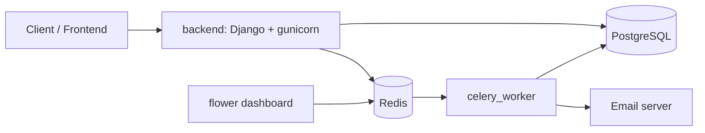

# Architecture

The project is a Django REST API that runs as several Docker containers.

## Services

| Service | Job |
|---|---|
| backend | Serves the REST API |
| db | PostgreSQL (staging and production; SQLite in development) |
| redis | Message queue for Celery |
| celery_worker | Runs background tasks, such as emails |
| celery_beat | Runs scheduled tasks (only when needed) |
| flower | Dashboard for watching Celery |

## Environments

| | development | staging | production |
|---|---|---|---|
| Docker target | dev | prod | prod |
| Server | runserver | gunicorn | gunicorn |
| Database | SQLite | PostgreSQL | PostgreSQL |
| Code | mounted from host | baked into image | baked into image |

## Conventions

- Every error response has the shape `{"error": {"code", "message", "details"}}`.
- API docs are generated by drf-spectacular at `/api/docs/`.
- Each app keeps its API code in `api/`, and big apps split `views/` and `urls/` into several files.