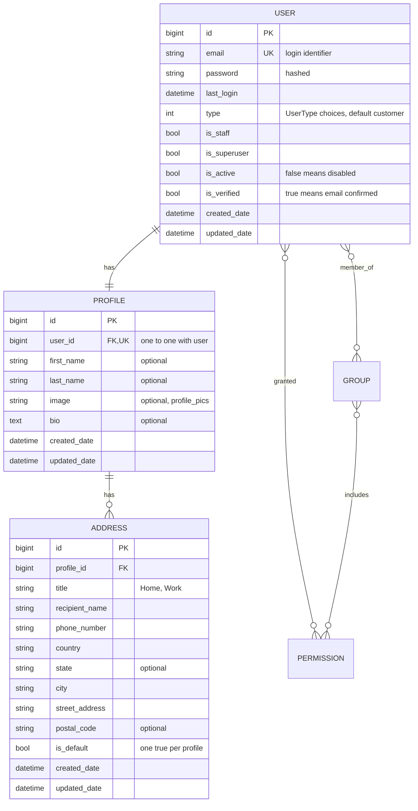
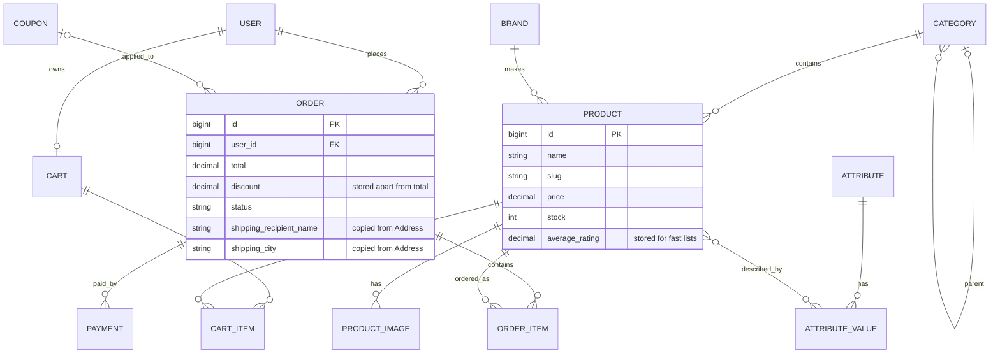

# Entity-relationship diagram

Update this file in the same pull request as any model change.

## Implemented: account app

### Notes

- A **Profile** is created automatically for every new user, by a `post_save` signal.
- **Address** has a conditional unique constraint, `one_default_address_per_profile`: each profile may have many addresses, but only one with `is_default = true`.
- `created_date` and `updated_date` on Profile and Address come from the abstract `TimeStampedModel` in `core`. It creates no table of its own.
- `password` and `last_login` come from `AbstractBaseUser`. `groups` and `user_permissions` come from `PermissionsMixin`, and Django's `auth` app owns the Group and Permission tables.
- Deleting a user deletes the profile, and deleting the profile deletes its addresses (`CASCADE`).

## Planned: shop, cart, order, payment

This is a draft, and it will change as the models are written.

### Notes

- **Order does not link to Address.** It copies the shipping fields at checkout, so editing or deleting an address never changes an old order. This also supports guest checkout.
- The `USER` in this diagram is the same `account.User` as above.